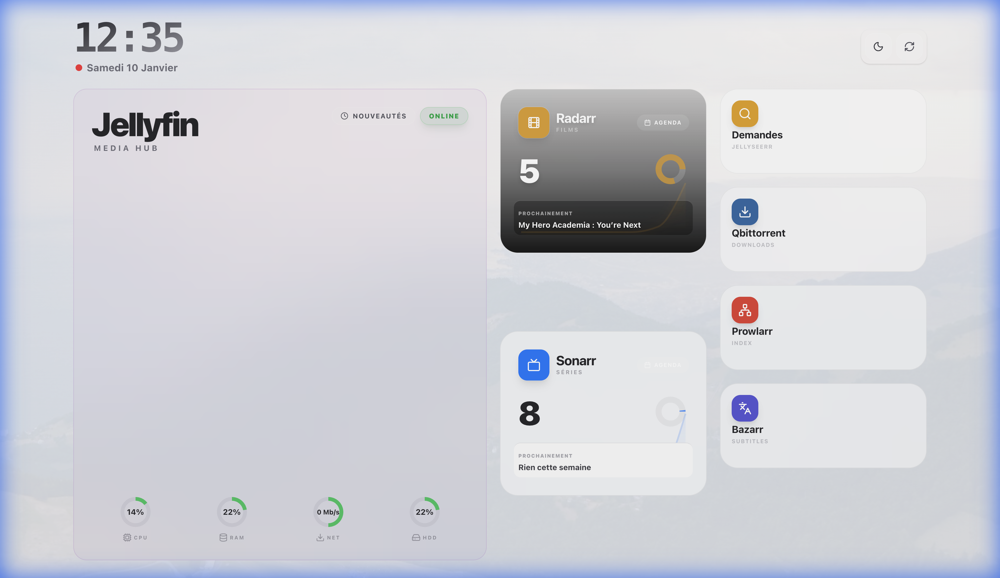
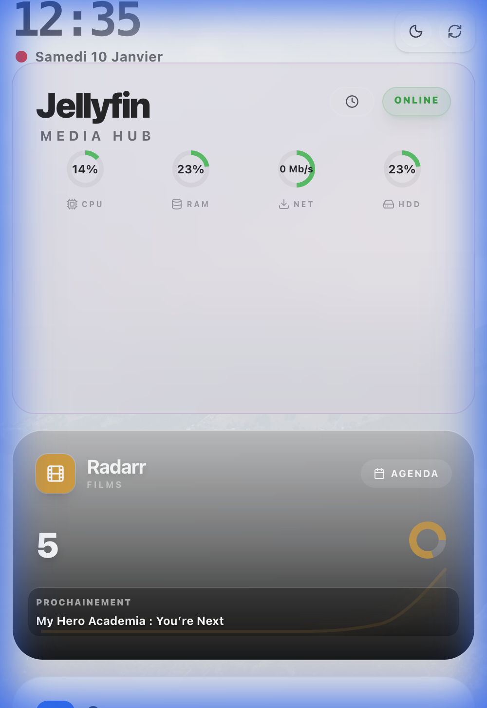

# Streaming Stack & Dashboard

Ma stack de streaming perso. Tout tourne sous Docker, avec un dashboard maison fait en Next.js pour piloter le tout.

<div align="center">
  
  
</div>

## Architecture



## Le Dashboard (Next.js)

J'ai codé une interface unifiée pour éviter de jongler entre les IPs de mes services.

- **Stats en temps réel** : Le dashboard tape directement dans les APIs de Radarr/Sonarr/qBit pour afficher ce qui se passe.
- **Sécurité** : L'accès extérieur est locké par Cloudflare Access (Code OTP mail).

## L'Infra (Docker)

Chaque service a son conteneur, tout communique sur un réseau interne.

- **Zero Port Ouvert** : Tout passe par un Tunnel Cloudflare.
- **Automatisation** : Jellyseerr gère les demandes, Radarr/Sonarr lancent les DLs via Prowlarr, qBit download, et Jellyfin pour le streaming.

## Services

| Service          | Rôle                           | URL (Interne)           |
| ---------------- | ------------------------------ | ----------------------- |
| **Dashboard**    | Mon interface                  | `http://localhost:8090` |
| **Jellyfin**     | Le Netflix maison              | `http://localhost:8096` |
| **Jellyseerr**   | Pour demander des films/séries | `http://localhost:5055` |
| **Radarr**       | Gestion Films                  | `http://localhost:7878` |
| **Sonarr**       | Gestion Séries                 | `http://localhost:8989` |
| **qBittorrent**  | Client Torrent                 | `http://localhost:8085` |
| **Prowlarr**     | Indexeurs                      | `http://localhost:9696` |
| **Bazarr**       | Sous-titres                    | `http://localhost:6767` |
| **FlareSolverr** | Bypass Cloudflare              | `http://localhost:8191` |

## Cloudflare Tunnel

Sécurité avant tout. Je voulais pas exposer mon IP.
Le conteneur `tunnel` maintient une connexion avec Cloudflare. Si vous voulez accéder au serveur, vous passez par eux.

## Setup

### Pré-requis

- Docker & Docker Compose
- Node.js (si vous souhaitez toucher au dashboard)

### Lancer le truc (Mode Auto)

J'ai fait un script qui configure tout tout seul (API Keys, .env, démarrage).

1. **Lancer le script**

   ```bash
   python3 setup.py
   ```

   Il va vous demander votre Token Cloudflare, lancer Docker, récupérer les clés API de Radarr/Sonarr automatiquement et configurer le dashboard.

2. **C'est tout**
   Le dashboard est sur le port `8090`.
